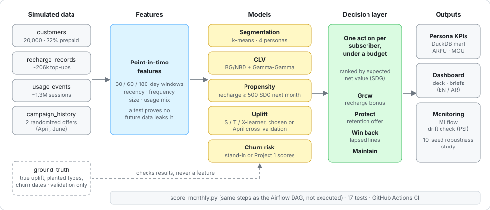

# Customer Value Map and Next-Best-Action

A data science project that extends my telecom data-engineering work. It reuses the [billing DWH](https://github.com/omnia077/telecom-billing-dwh)'s KPI definitions and Gold-layer design, and runs on the [Telecom Churn Platform](https://github.com/omnia077/Telecom-Churn-Platform)'s simulator, whose churn model can supply the risk input. It segments prepaid subscribers, estimates what each one is worth, finds who is persuaded by a recharge offer, and gives every subscriber one action under a budget — on a simulated telecom base with randomized campaigns, so every result can be checked against a known truth.

## Business Problem

A recharge offer is wasted on subscribers who would have recharged anyway. Targeting by *who is likely to buy* (propensity) picks exactly those "sure things". The money is in targeting *who buys because of the offer* (uplift), and in spending each contact where its expected value is highest.

## Objective

Build an end-to-end pipeline that describes the prepaid base in a few personas, estimates customer lifetime value, measures uplift on randomized campaigns, and allocates one action per subscriber — recharge bonus, retention offer, win-back or nothing — within a contact budget. Every model is validated on a time-based holdout or against the simulator's ground truth, and every headline result is repeated across 10 independent simulated worlds.

## Built On

This project sits downstream of two of my data-engineering projects:

- **[Telecom Churn Platform](https://github.com/omnia077/Telecom-Churn-Platform)** — the source of the simulator (extended here with planted customer types and randomized campaigns), the salted-hash subscriber IDs, and the churn model. Committed results use a simple stand-in for its scores; the real model is compared in `docs/project1_integration.md`
- **[Telecom Billing DWH](https://github.com/omnia077/telecom-billing-dwh)** — the source of the KPI definitions (ARPU, MOU) mirrored in the persona mart, and the Gold-layer star-schema pattern. `dim_segment` and `fact_customer_value` are shaped to load into its Gold layer

No data flows from the billing DWH: it holds a different population and no recharge events.

## Data Sources

All data is simulated by `data_generation/phase1b_generate_data.py` (20,000 customers, 72% prepaid, 2024):

- **customers** — `customer_id`, `msisdn`, `region`, `plan_type`, `age`, `gender`, `activation_date`, `monthly_arpu_sdg`
- **recharge_records** — `customer_id`, `recharge_date`, `amount_sdg`, `channel` (~206k rows)
- **usage_events** — `customer_id`, `event_date`, `usage_type` (data, voice, sms), `usage_value` (~1.3M rows)
- **campaign_history** — two randomized "recharge bonus" offers (April, June): `campaign_id`, `customer_id`, `sent_date`, `treated`
- **ground_truth** — planted customer types, true individual uplift, churn dates. Used only to validate, never as a feature

## 🏗️ Data Architecture



Simulated tables pass through **point-in-time features** (only events up to the as-of date, enforced by a test) into five models: segmentation, CLV, propensity, uplift and churn risk. The **decision layer** turns their outputs into one action per subscriber, ranked by expected net value under a contact budget. Results land in a persona KPI mart (DuckDB), a dashboard, a deck and briefs in English and Arabic. Ground truth only checks the results.

## 📐 Decision Layer — One Action per Subscriber

| Action | Expected net value (SDG) | Validated against truth? |
|---|---|---|
| **Grow** — recharge bonus | uplift × average added recharge − offer cost | Yes |
| **Protect** — retention offer | churn probability × save rate × value if alive − cost | No, save rate is assumed |
| **Win back** — lapsed lines | win-back rate × (1 − p_alive) × value if alive − cost | No, win-back rate is assumed |
| **Maintain** | 0 | — |

Each subscriber gets the best action with positive value; the top 30% by value are contacted. All cost and rate assumptions live in `config/customer_value.yaml`.

## Key Design Decisions

- **Uplift over propensity** — a propensity model ranks "sure things" first. On the randomized campaign its ranking correlates *negatively* with the true effect of the offer.
- **Learner chosen on April only** — five uplift learners are compared by cross-validation on the April campaign; June is the untouched test.
- **Point-in-time features** — every feature is computed as of a cutoff date, and a test deletes all later events and checks nothing changes.
- **BG/NBD for lifetime value** — prepaid lines have no cancellation event, so dropout is inferred. It is benchmarked against a simple baseline and a LightGBM model, not assumed to win.
- **Ground truth for validation only** — a test restricts which modules may read it.
- **Robustness before claims** — the study is repeated on 10 freshly simulated worlds; seed 42 turned out to be a favourable draw, so headline numbers use the 10-world mean.
- **Assumptions in one place** — offer cost, save rate and win-back rate are labelled assumptions with break-even and sensitivity analysis.


## What It Found

Comparisons between targeting rules are averages over 10 simulated worlds at a 30% contact budget. Persona, action-plan and Project 1 figures come from the main run (seed 42):

- **Propensity targeting lost money in every world** — −23k SDG, against +192k for uplift targeting and +88k for random
- **Uplift ranks subscribers correctly** — rank correlation with the true effect +0.56 (0.50 to 0.65); propensity −0.62
- **The largest group by revenue is mostly sure things** — core high-value subscribers are 26% of the base and 54% of revenue, with the highest propensity and below-average uplift
- **BG/NBD beats last-90-day spend but not ML** — RMSE 1,961 vs 2,181 SDG (10% lower), and 1,939 for LightGBM
- **Targeting beats contacting everyone from about 20 SDG per contact** (range 12 to 25); at the assumed 25 SDG the edge is small, +5% on average
- **Action plan** — 3,876 of 12,921 active subscribers get one action, worth about 365k SDG, of which 166k is validated against truth
- **Project 1's real churn model** ranks risk better than the stand-in (AUC 0.773 vs 0.746) and its retention group churns 7.1% vs 3.9%


## ⚠️ Limitations

- **All data is simulated.** Results demonstrate the method, not real-world performance. The uplift direction is built into the simulator.
- **About half the expected value rests on assumed rates** (win-back and retention). They stay positive even if the true rates are half as large, but a pilot must measure them.
- **Committed results use a stand-in churn model** so they reproduce from a clone. Project 1's real scores are compared separately (`docs/project1_integration.md`).
- **The Airflow DAG has not been executed** and the GitHub Actions workflow has not run yet.

## Platform Components

- **pandas + pyarrow** — feature building over Parquet
- **scikit-learn + LightGBM** — k-means, propensity, uplift learners
- **scipy** — own BG/NBD and Gamma-Gamma implementation (`lifetimes` is unmaintained)
- **DuckDB** — persona KPI mart, using the billing DWH's ARPU and MOU definitions
- **MLflow** — run tracking (sqlite backend)
- **Airflow DAG** — `customer_value_monthly`, waits for the churn DAG (written, not executed)
- **pytest + GitHub Actions** — 17 tests; CI regenerates the data and reruns everything

## 🚀 Quick Start

```bash
# 1 — Install dependencies
pip install -r requirements.txt

# 2 — Generate the simulated data (~150 MB, not committed)
python data_generation/phase1b_generate_data.py --archetypes --campaign

# 3 — Run the full pipeline (a few minutes)
python src/score_monthly.py

# 4 — Build the dashboard and run the tests
python src/dashboard.py            # outputs/dashboard.html
python -m pytest tests -q

# Optional — robustness study on 10 simulated worlds (about 15 minutes)
python src/multiseed.py --seeds 1-10 --workdir /tmp/seeds
```

## 📂 Repository Structure

```
customer-value-next-best-action/
│
├── config/
│   └── customer_value.yaml          # Windows, cut-offs, seeds, every cost/rate assumption
│
├── data_generation/
│   └── phase1b_generate_data.py     # Simulator: archetypes + randomized campaigns
│
├── src/
│   ├── features.py                  # Point-in-time features
│   ├── segment.py                   # k-means personas + recovery check vs planted types
│   ├── clv.py                       # BG/NBD + Gamma-Gamma vs baselines
│   ├── propensity.py                # Recharge >= 500 SDG next month
│   ├── uplift.py                    # 5 learners, April CV selection, June test vs truth
│   ├── churn_proxy.py               # Stand-in churn scores + Project 1 adapter
│   ├── ids.py                       # MSISDN hashing, Project 1 score validation
│   ├── actions.py                   # One action per subscriber under a budget
│   ├── persona_kpis.py              # DuckDB: ARPU, MOU by persona
│   ├── score_monthly.py             # Whole pipeline: validate → models → actions → drift → MLflow
│   ├── customer_value_dag.py        # Airflow DAG (same steps)
│   ├── multiseed.py                 # 10-world robustness study
│   ├── compare_churn_sources.py     # Stand-in vs Project 1's real scores
│   ├── dashboard.py                 # Single-file HTML dashboard
│   └── build_deck.py                # 5-slide deck
│
├── tests/
│   └── test_customer_value.py       # 17 tests
│
├── outputs/                         # Results (CSV, JSON, dashboard) — see outputs/README.md
│
├── docs/
│   ├── model_card_customer_value.md
│   ├── design_decisions.md
│   ├── uplift_design.md
│   ├── project1_integration.md
│   ├── bi_data_requirements.md
│   ├── director_brief.md            # English
│   ├── director_brief_ar.md         # Arabic
│   ├── glossary_ar.md
│   ├── customer_value_deck.pptx
│   └── img/                         # Architecture diagram, dashboard screenshots
│
├── .github/workflows/ci.yml
├── requirements.txt
├── LICENSE
├── .gitignore
└── README.md
```

## 📋 Requirements

- Python 3.12+
- No Java needed (no Spark in this project)
- Tested package versions pinned in `requirements.txt`
- About 150 MB of disk for the generated data

## License

MIT — see [LICENSE](LICENSE).
