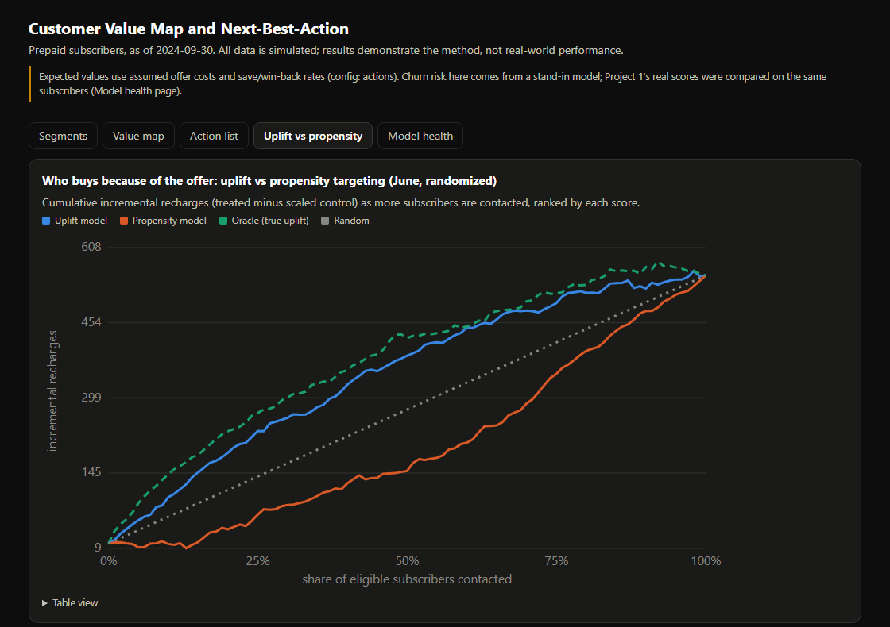
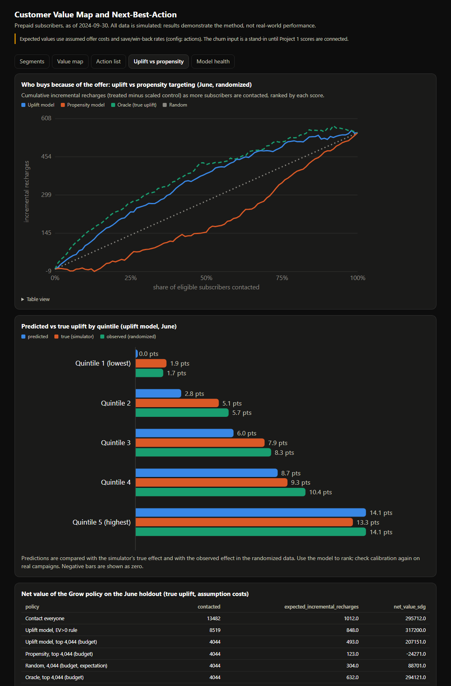
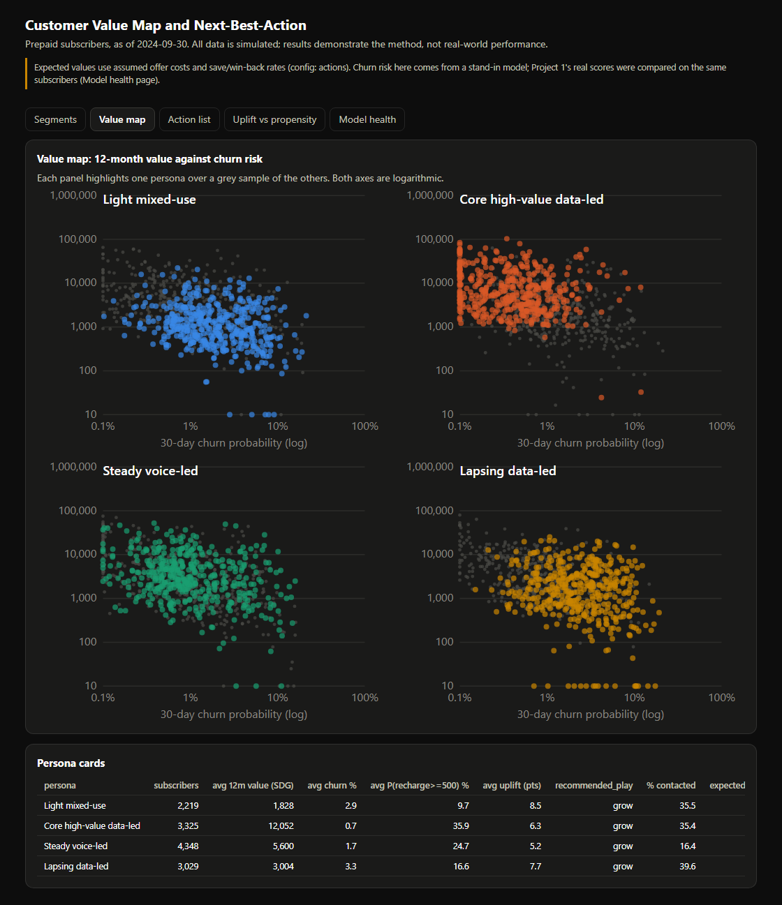
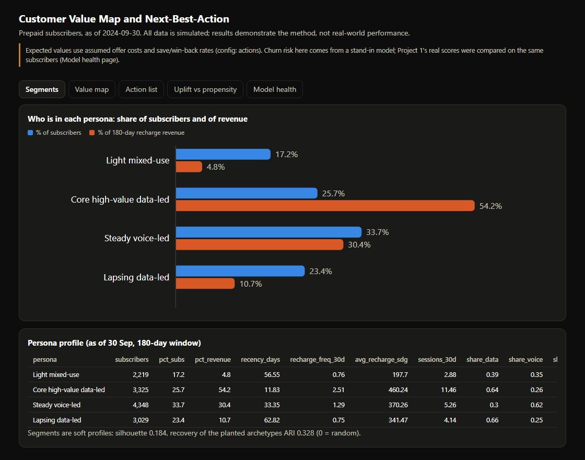
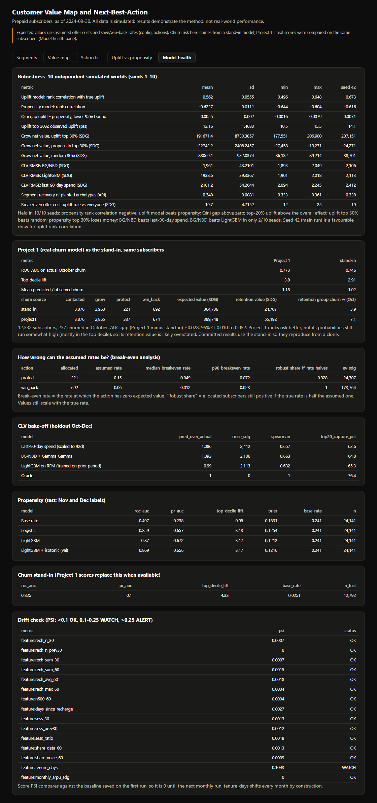

# Customer Value Map and Next-Best-Action

For each prepaid subscriber: **who they are** (persona), **what they are worth** (CLV), **who is persuaded by an offer** (uplift) and **what to do** (one action under a budget).

> A propensity model tells you who will buy. An uplift model tells you who buys *because of the offer*. On the simulated randomized campaign, targeting by propensity did worse than random in every one of 10 independent simulated worlds.

**All data is simulated** (`data_generation/phase1b_generate_data.py --archetypes --campaign`, 20,000 customers). Results demonstrate the method, not real-world performance.



<details><summary>More dashboard pages (screenshots)</summary>









</details>

The interactive version is `outputs/dashboard.html` (also uploaded as an artifact by each CI run).

## Headline results

The main run uses simulator seed 42. **Seed 42 is a favourable draw for uplift**, so quote the 10-seed column (`src/multiseed.py`: seeds 1-10, each a freshly simulated world, same code and settings).

| Result | Main run (seed 42) | 10 simulated worlds: mean (range) |
|---|---|---|
| Uplift model rank correlation with the true effect (S/T/X-learner chosen on April CV) | **+0.67** | **+0.56** (0.50 to 0.65) |
| Propensity model rank correlation with the true effect | **-0.62** | **-0.62** (-0.64 to -0.60) |
| Qini gap, uplift minus propensity: lower 95% bound | +0.0071 | +0.0055 (0.0016 to 0.0079): above zero in 10/10 |
| Observed uplift in the top 20% (pts), overall effect in brackets | 14.1 (8.2) | 13.2 (7.8): interval above the overall effect in 10/10 |
| Grow policy, 30% budget: uplift / random / propensity (SDG, true uplift) | 207k / 89k / **-24k** | 192k / 88k / **-23k**; propensity negative in 10/10 |
| Uplift EV rule vs contacting everyone at a 25 SDG offer (SDG) | 317k vs 296k | 308k vs 294k: **+4.9% on average, +0.4k in the worst seed** |
| Offer cost above which the uplift rule beats contacting everyone | 19 SDG | 19.7 SDG (12 to 25) |
| CLV holdout RMSE: BG/NBD / last-90-day spend / LightGBM (SDG) | 2,106 / 2,412 / 2,113 | 1,961 / 2,181 / 1,939 |
| Segments: recovery of planted archetypes (ARI), silhouette | 0.33, 0.18 | 0.35 (0.33 to 0.36), 0.18 |

Single-run results (not repeated across seeds): propensity (Nov, Dec) ROC-AUC 0.870, PR-AUC 0.672, top-decile lift 3.2x, well calibrated. Population 12,921 active prepaid subscribers as of 30 Sep 2024. Action plan: 3,876 subscribers (30%) get one action (2,963 recharge bonus, 692 win-back, 221 retention); expected net value 365k SDG, of which **166k (46%) is validated against simulator truth** and 199k rests on assumed rates.

## Caveats (read before quoting any number)

- **Uplift direction is by design.** The simulated offer converts only people who would not otherwise have recharged 500+ SDG. The method and its evaluation against known truth are the demonstration, not the effect size.
- **BG/NBD wins against the simple baseline, not against ML.** It beats last-90-day spend in 10/10 seeds (about 10% lower RMSE) but beats LightGBM in only 2/10 (about 1% worse on average). Present it as a bake-off, not a win.
- **Learner choice is not fixed.** April cross-validation picked the S-learner in 6 seeds, the regularised T-learner in 3 and the X-learner in 1. The CV-selected learner beats a fixed T-learner in 10/10 seeds.
- **The 25 SDG edge over contacting everyone is small.** Targeting pays clearly from about 50 SDG per contact (at 50 SDG, contacting everyone loses 41k in the main run while the uplift rule earns 109k) or under a budget (`outputs/grow_sweep_offer_cost.csv`, `grow_sweep_budget.csv`).
- **54% of expected value rests on assumed rates** (win-back 174k, retention 25k). Break-even analysis (`outputs/assumption_breakeven.csv`): both actions stay positive for 93% and 100% of allocated subscribers if the true rate is half the assumed one, but value scales down. `p_alive` ranks lapse risk correctly (84% of "alive" lines recharge in the next 92 days vs 27% of "probably lapsed"), yet that 27% means win-back value is an upper estimate until a pilot measures it.
- **Churn input.** Committed results use a stand-in (`src/churn_proxy.py`) so they reproduce from a clone. Project 1 was re-run on this dataset with the real salt and compared on the same subscribers: it ranks risk better (AUC 0.773 vs 0.746; gap +0.028, 95% CI 0.010 to 0.052) and its retention group churns more (7.1% vs 3.9% in October), but its probabilities still run somewhat high (1.18x overall after its switch to Platt calibration, 1.7x in the top decile), so its retention value (55k SDG) is probably overstated. Details, runbook and numbers: [docs/project1_integration.md](docs/project1_integration.md).
- BG/NBD assumes purchase rate and dropout are independent; the simulator ties both to one hidden state, so that is violated by design. Campaign-induced recharges (April, June) are in the CLV fit window.
- **Billing DWH is reused for KPI definitions only** (ARPU, MOU mirrored in DuckDB). It holds a different population and no recharge events; regenerating it with shared customers was considered and not recommended.
- The Arabic brief was reviewed by a native reader (no changes requested). Terminology reference: [docs/glossary_ar.md](docs/glossary_ar.md).
- **CI is written but has not run on GitHub yet.** `.github/workflows/ci.yml` regenerates the data, runs the pipeline and the tests.

## Run it

```bash
pip install -r requirements.txt                                            # tested versions pinned
python data_generation/phase1b_generate_data.py --archetypes --campaign    # writes data_v2/ (gitignored, ~150 MB)
python src/score_monthly.py                                                # whole pipeline; name steps to run a subset
python src/dashboard.py                                                    # outputs/dashboard.html (deep links: #t0 ... #t4)
python src/build_deck.py                                                   # docs/customer_value_deck.pptx
python -m pytest tests -q                                                  # 17 tests
python src/multiseed.py --seeds 1-10 --workdir /tmp/seeds                  # robustness study, about 15 minutes
# needs Project 1 scored on this data and CHURN_HASH_SALT (see docs/project1_integration.md):
python src/compare_churn_sources.py --scores data_external/churn_scores_project1.parquet --key sub_hash --prob probability
```

Individual stages: `python src/segment.py [--select]`, `clv.py`, `propensity.py`, `uplift.py`, `churn_proxy.py`, `actions.py`, `persona_kpis.py`.

## CRISP-DM map

| Phase | Where |
|---|---|
| Business understanding | This README; `docs/director_brief.md` (EN) / `docs/director_brief_ar.md` (AR) |
| Data understanding | `docs/uplift_design.md` (randomization checks); `src/features.py` |
| Data preparation | `src/features.py`: point-in-time features (a test proves no future data) |
| Modelling | `src/segment.py`, `clv.py`, `propensity.py`, `uplift.py`, `churn_proxy.py`, `actions.py` |
| Evaluation | `outputs/*.csv|json`; checks against simulator truth in `segment.py`, `uplift.py`, `actions.py`; robustness in `multiseed.py` |
| Deployment | `src/score_monthly.py`, `src/customer_value_dag.py`, `src/persona_kpis.py`, `outputs/dashboard.html`, MLflow (`mlflow.db`, gitignored), CI |

## Pipeline and outputs

`validate inputs -> segment -> CLV -> propensity -> uplift -> churn scores -> actions -> persona KPIs -> drift check -> MLflow`

Tables in `outputs/` (Parquet, gitignored, regenerated by the pipeline): `segment_assignments`, `clv_scores`, `propensity_scores`, `uplift_scores`, `churn_scores`, `customer_actions`; `outputs/mart/`: `persona_kpis_monthly`, `dim_segment`, `fact_customer_value`. Results as CSV/JSON, the multi-seed study and the dashboard are committed.

## Decisions and deviations from the working spec

| Item | What was done | Why |
|---|---|---|
| k | 4 (k=3 was more stable: ARI 0.95 vs 0.89) | k=4 separates a very low-value group (4.8% of revenue) from a lapsing data-led group (10.7%), which need different actions. k was **not** chosen on the recovery score |
| GMM | Tried in an early run (BIC unreliable for k>=6); not in the final module | Adds nothing over k-means here |
| Population | Active in last 90 days | Sensitivity run: without the rule 11% of lines had already churned and skewed two segments; conclusions otherwise similar (`outputs/k_selection_*.csv`) |
| CLV library | Own BG/NBD + Gamma-Gamma (`src/clv.py`) | `lifetimes` is unmaintained and fragile with pandas 3. Formula checked against Monte Carlo (92-day expectation 6.086 vs 6.086); fitted a=0.07 (<1) is valid |
| Uplift learners | 5 compared, chosen by April cross-validation | A fixed T-learner had rank correlation +0.47 (seed 42) / +0.39 (10-seed mean); the CV-selected learner +0.67 / +0.56. June was never used to choose |
| Propensity features | Segment ID **not** used | Segments are fit as of 30 Sep; using them at earlier cutoffs would leak the future |
| Churn | Committed results use the stand-in; Project 1 re-run on the shared data and compared (`compare_churn_sources.py`) | Real scores need the salt and cannot be regenerated by CI |
| Win-back value | Weighted by (1 - p_alive) | First version priced every lapsed line as truly gone and over-allocated budget |
| Airflow | DAG written, **not executed** | Airflow not installed here; the same steps are run and tested through `score_monthly.py` |
| Model registry | Not used; metrics and artifacts logged to MLflow (sqlite) | Scores are produced by the run that trains the models |
| Billing DWH | KPI definitions mirrored; `dim_segment` / `fact_customer_value` ready for its Gold layer | Different population, see caveats |
| ID hashing | `customer_id` everywhere; hashing helper matches Project 1's scheme | No MSISDN reaches any output |

## License

MIT, see [LICENSE](LICENSE). The data is simulated; no real subscriber data is included.

## Governance

Segments and CLV are commercially sensitive: restrict by role. `age`, `gender`, region and MSISDN are not model inputs; `outputs/fairness_audit.csv` shows contact rates by age band (27.2-31.5%) and region (27.7-33.0%). One action per subscriber per period (`test_actions_one_per_subscriber_and_budget`). Document retention and permitted use of campaign data before real use.

## Repository layout

```
config/customer_value.yaml      windows, cut-offs, seeds, assumptions (all cost/rate assumptions live here)
data_generation/                simulator (archetypes + randomized campaigns)
src/                            features, segment, clv, propensity, uplift, churn_proxy, actions, ids, persona_kpis,
                                score_monthly, customer_value_dag, multiseed, dashboard, build_deck
tests/                          17 tests (point-in-time safety, ground-truth access, allocation, adapters, seed robustness)
docs/                           model card, uplift design, Project 1 integration, BI requirements, briefs (EN/AR), glossary, deck, img/
outputs/                        results (CSV/JSON/dashboard committed; Parquet tables regenerated)
.github/workflows/ci.yml        regenerate data, run pipeline and tests
```
